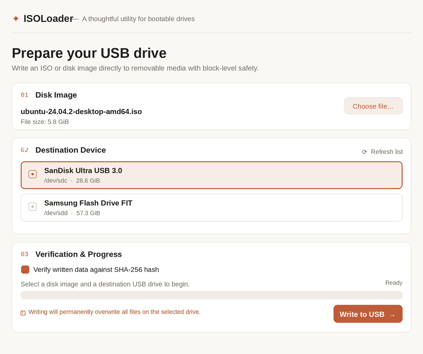
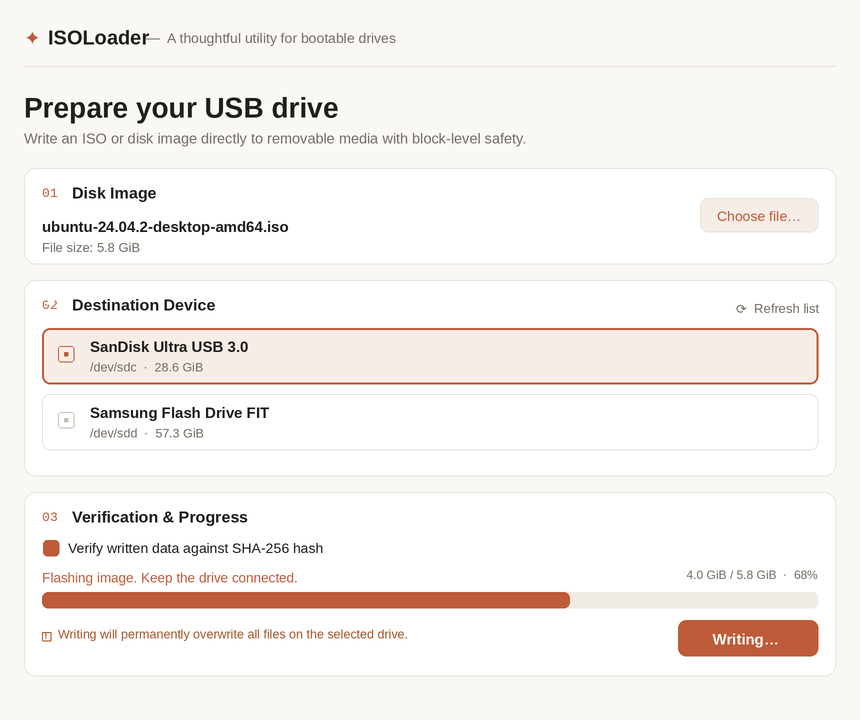

# ISOLoader

**Write ISO and disk images to USB drives — on Android, without root, and on Ubuntu desktop.**

ISOLoader is an open-source alternative to Rufus / DROFUS. The storage protocol is implemented in Rust;
the Android app talks to USB mass-storage devices directly over USB Host (OTG), and the Ubuntu app writes
to block devices with the same safety checks and optional SHA-256 read-back verification.





## Features

- Android USB Host / OTG, **no root required**.
- ISO/IMG selection through the system document picker (Storage Access Framework).
- USB Mass Storage Bulk-Only Transport (BOT) and SCSI implemented in Rust:
  `INQUIRY`, `TEST UNIT READY`, `READ CAPACITY(10/16)`, `READ(16)`, `WRITE(16)`, cache sync.
- Optional read-back verification with SHA-256.
- CLI companion: `rufus-rust` in `cli/`.
- Ubuntu desktop GUI (`.deb` package) in `ubuntu/`.
- Android ABIs: `arm64-v8a`, `armeabi-v7a`, and `x86_64`.

## Install

### Ubuntu (`.deb`)

```bash
sudo apt install ./ISOLoader_0.1.0_amd64.deb
isoload-gui
```

The app appears in the application menu as **ISOLoader**. It needs OpenGL and X11/Wayland, which ship with
Ubuntu desktop. Run it as your normal user; grant that user write access to the target block device
(for example through the `disk` group) — the application does not elevate privileges itself.

### Android

Install `ISOLoader-debug.apk` (release builds should be signed with your own key), connect the USB drive
through an OTG adapter, pick an image, and tap write.

## Use

1. Choose an ISO/IMG/DMG image.
2. Select the target USB device — non-removable disks are listed but refused for writing.
3. Optionally enable SHA-256 verification.
4. Confirm the destructive-write warning and write.

<p align="center">
  
</p>

## Build

### CLI

```bash
cd cli
cargo build --release
```

### Ubuntu desktop app

Rust/Cargo plus OpenGL and X11/Wayland development libraries (eframe/egui, no GTK headers required):

```bash
cd cli
cargo build --release --features desktop --bin isoload-gui
../ubuntu/build-deb.sh                     # produces ISOLoader_<version>_<arch>.deb
```

The desktop app lists Linux block devices from sysfs, requires removable-device detection, checks that the
image fits, asks for confirmation, writes in a worker thread, flushes the target, and optionally verifies
the written bytes with SHA-256.

The screenshots are rendered by `make_screenshots.py` from the same layout as `cli/src/gui.rs`.

### Android native core

Install Android NDK and Rust Android targets, then build `android/` for the required ABI. The checked-in
`.cargo/config.toml` contains local paths from the development machine and should be adjusted for another
environment.

### APK

`android-app/` is a minimal SDK-style Android project without Gradle. It uses a small Java Activity only
for Android lifecycle, SAF file selection, USB permission, and `UsbDeviceConnection`; all storage protocol
and data writing is Rust code.

The APK is assembled with `aapt2`, `javac`, `d8`, `zipalign`, and `apksigner`. Do not use the development
keystore for a public release; configure your own signing key.

## Design

The desktop interface uses a calm editorial palette — warm ivory surfaces, white cards, a terracotta
accent — with explicit numbered steps (image → destination → verification) so the destructive action is
never more than one glance away from its warning.

## Safety

Flashing irreversibly overwrites the selected USB device. The app checks the image size against the reported
device capacity and asks for explicit confirmation. Test against disposable hardware before distributing.

Hardware validation on real Android phones and multiple USB bridges is still required before claiming broad
device compatibility.

## License

MIT
